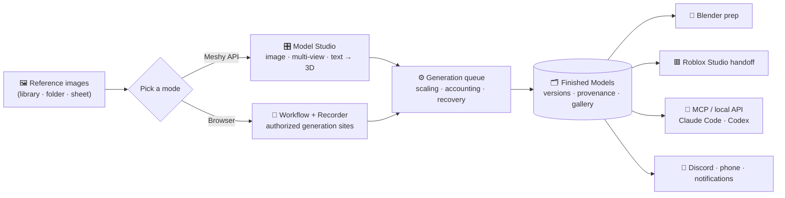
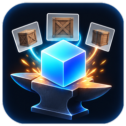

<p align="center">
  
</p>

<h1 align="center">RefForge</h1>

<p align="center">
  <strong>Turn reference images into game-ready 3D models — on your own machine, on your own terms.</strong>
</p>

<p align="center">
  <a href="https://github.com/bruceisbxe/refforge-releases/releases/latest"></a>
  
  
  
</p>

<p align="center">
  
  
  
  
  
</p>

---

**RefForge** is a local-first Windows desktop app that takes your reference images and forges them into
3D models — then tracks every version, prepares them in Blender, and hands them off to Roblox Studio or to
your AI coding agents. Your data, browser profiles and API keys stay on your PC, encrypted with the OS
credential store. No telemetry.

It works two ways, and you pick per workspace:

| | 🎛️ **Meshy API mode** | 🧭 **Browser mode** |
|---|---|---|
| **How** | Sends your references straight to [Meshy](https://www.meshy.ai) with **your own** API keys | Visually builds, runs, watches and debugs **authorized** browser automations for generation sites |
| **Best for** | Fast, metered, no browser needed | Sites without an API, where you drive your own logged-in session |
| **You get** | Model Studio, live credit/cost tracking, post-processing chains | A workflow editor, recorder, run history and a scaling generation queue |

Both modes drop results into the same **Finished Models** library, so the rest of the pipeline — versions,
provenance, Blender, Roblox, AI access — is identical no matter how a model was made.

---

## ⬇️ Download

<p align="center">
  <a href="https://github.com/bruceisbxe/refforge-releases/releases/latest"></a>
</p>

1. Grab the latest **`RefForge-Setup-x.y.z.exe`** (full) or **`RefForge-Lite-Setup-x.y.z.exe`** (Meshy-only)
   from the [**Releases**](https://github.com/bruceisbxe/refforge-releases/releases) page.
2. Run it. The build isn't code-signed yet, so Windows SmartScreen may say *"Windows protected your PC"* →
   click **More info → Run anyway**.
3. (Optional) verify the download against the `SHA-256` in the release notes:
   ```powershell
   Get-FileHash .\RefForge-Setup-x.y.z.exe
   ```
4. Installed copies **update themselves** — check **Settings → Updates**.

First run walks you through a short setup guide (Meshy keys, or your first authorized site) right in the app.

### Two editions

| | **RefForge** | **RefForge Lite** |
|---|:---:|:---:|
| Meshy API mode | ✅ | ✅ |
| Browser automation mode | ✅ | — |
| Bundled Chromium | ✅ | — |
| Installer size | ~283 MB | ~130 MB |

Both install side by side and never install each other's updates.

---

## ✨ Features

- 🖼️ **References → 3D, your way** — image, multi-view, or text-to-3D via Meshy, or your own authorized
  browser workflows for sites that have no API.
- 🔐 **Local-first & private** — SQLite on disk, isolated Chromium profiles, every secret sealed with
  Windows DPAPI. No telemetry.
- 🧰 **Model Studio** — the full Meshy settings panel with **live cost estimates** and **credits remaining**
  per account before you spend a thing.
- ♻️ **Post-processing chains** — remesh, retexture, rig and animate, queued and tracked.
- 🗂️ **Finished Models library** — per-version thumbnails, provenance, filters, sort, grid/list and bulk
  actions.
- 🧱 **Blender & Roblox handoff** — one-click "Prepare in Blender", then a verified export → import bridge
  into Roblox Studio.
- 🤖 **AI-agent access** — a built-in **MCP server** + local API lets Claude Code / Codex submit references,
  read status and pull finished models, with scoped tokens and an activity log.
- 📚 **Reference libraries** — import a folder of references (forgiving importer + a sheet splitter for
  contact-sheet images), map views, feed them into generation.
- 🔁 **Crash-safe pipeline** — a scaling generation queue with accounting, checkpoints and startup recovery.
- 📣 **Stay in the loop** — Discord webhook updates, in-app + OS notifications, and a phone dashboard over
  LAN (HTTPS, paired).
- 🔄 **Auto-updates** — installers update themselves from GitHub Releases.

---

## 🧭 How it flows



---

## 🧱 Built with

Electron · React 19 · TypeScript · Tailwind CSS v4 · Playwright (Chromium) · SQLite (`better-sqlite3`) ·
three.js · Zustand — a context-isolated, sandboxed renderer over an Electron-free TypeScript core.

## 🛡️ Security & privacy

- **Renderer lockdown:** context isolation, sandbox, no Node integration, strict CSP, no arbitrary
  navigation; every IPC payload is validated.
- **Sealed secrets:** API keys, site passwords and tokens are encrypted with the OS credential store (DPAPI,
  bound to your Windows user) and never leave your machine.
- **No shady automation:** isolated Chromium profiles, and **no** stealth/evasion, fingerprint spoofing,
  CAPTCHA bypass or automated account creation — RefForge only drives sites you're authorized to use.
- **Hardened packaging:** Electron fuses disable `RunAsNode`, `NODE_OPTIONS` and `--inspect` and force
  load-from-asar; the app core can ship as obfuscated V8 bytecode, and installs are protected by
  machine-locked license keys.

---

## 📄 License

RefForge is **proprietary** software (not open source), licensed under its
[End User License Agreement](EULA.md). It is provided **"as is" with no warranty**, the Licensor's liability
is limited, and **you are solely responsible** for using it lawfully and only on services and accounts you
are authorized to use, in line with their terms (Meshy, Roblox, and any site you automate). By downloading
and using RefForge you agree to the [EULA](EULA.md).

---

<p align="center">
  
</p>

<p align="center">
  Built by <strong>BruceIsBxe</strong> · Community: <a href="https://discord.gg/bruceisbxe">discord.gg/bruceisbxe</a>
</p>

<p align="center"><sub>This repository hosts RefForge release installers. RefForge is proprietary software — © 2026 Bryce. All rights reserved.</sub></p>
